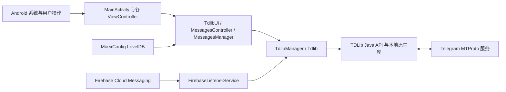

# moeGramX Ghost 项目说明

## 当前 1813 分支的边界

`codex/upgrade-1813` 是独立的 1813 依赖升级工作树，以 moeGramX 的 `79e4d5d2` / TGX `9312ace3` 完整上游代码为兼容基线，包含上游通知 tag、联系人同步服务、备份限制和 Baseline Profile 等关联改动。通知交接与 Google Maps SDK 配置修复均基于该工作树。1813 Release 从该分支的明确提交打标，仍与 `moe` 日常分支保持独立；通知、地图和既有回归检查的通过不代表全部上游功能都已完成兼容性验证。

本工作树使用 TDLib wrapper `a032dcf1`（源码 `d1085f9c`）、Gradle 9.7.1、JDK 21、NDK `27.3.13750724`、SDK `android-37.2`。ARM64 使用 `c++_shared`；TDLib 和 OpenSSL 路径均增加 NDK 版本层。`patches/tdlib-ghost-mode.patch` 改为保留 3 行上下文的补丁，按函数重新移植到新 TDLib，不能把旧零上下文补丁直接套在新版本上。

## Forum Topics 模块

`app/src/main/java/moe/kirao/mgx/topics/` 提供论坛话题列表、搜索、分页、顶部／侧边话题标签、话题图标及编辑页。界面以 XGram `a1e55945` 的标准 TGX 布局为基础，核心行为参考 `628f896e`，没有引入 Expressive/M3 主题；聊天列表中论坛的未读徽标见下文。`XgramForums` 负责论坛识别、打开列表／话题、管理菜单、分享目标及通知跳转；宽屏下沿现有 `MoexTwoPane` 打开右栏，单栏沿原导航栈。创建、编辑、置顶、关闭、静音等有权限的操作由用户入口调用 TDLib。

`MessagesLoader` 使用 `GetForumTopicHistory` 获取当前话题历史，合并媒体也限制在当前话题；`MessagesManager` 按准确的 `MessageTopicForum.forumTopicId` 接收实时消息，未指定话题的论坛消息只归 General。话题独立草稿、读取位置、未读分隔、已发送消息回执、资料和媒体入口沿现有消息控制器整合。列表预览继续使用 Shadow Ban 和正则过滤，黑名单未知时不展示未过滤内容，名单变化会刷新预览。Ghost Mode 的话题本地已读由 TDLib 原生 `ForumTopic`／`ForumTopicManager` 处理，不引入第二套 Java 已读数据库。服务器读取位置和原始未读数与本地读取位置、剩余数分别维护；同一可见窗口重复上报不会再次扣数，到达已知话题尾部归零，元数据返回时保留更靠后的本地进度。读取状态以带版本的 6 个整数保存在现有账号 binlog 键值存储的 `moex_topic_read:<chatId>:<topicId>` 中，首次加载话题时从内存中的键值表恢复；不启用本版 TDLib 原本关闭的 MessageThreadDb。服务器追上本地进度后移除额外状态；删除单个话题（本机删除或服务器返回已删除话题）时擦除该话题的键，删除整个论坛时按 `moex_topic_read:<chatId>:` 前缀清理。此数据按账号数据库隔离，普通进程关闭不删除。

服务器读取边界不变时，新的未读数按服务器计数变化与本地已读差额合并；服务器边界与消息尾部同时变化、无法精确推断重叠时保守保留未读，加载历史后再校准。删除旧消息和新增消息可能抵消总数变化，尚未读到的新尾部不会仅因差额为零而被直接清成 0。群组 Ghost 开启时仍不发送 `ReadForumTopicQuery`；关闭时沿原有服务器读取流程。Shadow Ban 和正则过滤继续生效，修复不把单个话题读取扩大为整个群已读，也不新增论坛全历史扫描或后台轮询。

聊天列表和搜索结果中按话题打开的论坛显示“已知未读话题个数”，按消息合并查看的论坛仍用群级计数。群级 `unread_count` 不是 Topic 已读状态的依据，包括它变为 0 的情况；当前原生整群已读流程不读取各个 Topic。所有已知未读话题都静音时徽标为灰色，有会通知的话题时使用正常颜色。首次只读取最新 20 个话题，话题列表随后加载到的更多话题也计入；这里不通过全论坛扫描取得完整总数，文件夹标签和应用总未读仍由 TDLib 按群级计数汇总。

`ForumUnreadBadges` 通过 `ForumRequests` 加载，账号内一次只处理一个论坛，有相同请求时合并；没有可见行的论坛出队时跳过。失败按服务器 `retry after` 或 30 秒等待，到行再次显示时再试，不在后台轮询。群级读取位置移动或未读话题最后一条消息被删除时，2 秒后刷新第一页；加载期间再次失效用代次保留，旧响应回来后补读一次。UI 超时不释放尚未真正回调的原生请求槽位。

`ForumUnreadTopics` 对完整页替换全部已知话题，对不完整页只更新页内话题，保留页外状态。删除一条消息不等于该话题所有消息已读；最后消息被删除或缺席位置不确定的已知未读话题，每页最多挑 8 个，经同一队列逐个 `GetForumTopic` 核实。失败保留原状态；服务器明确回答话题不存在时移除。按创建时间排序的论坛可能合法缺席，核实后且最后消息未变时不重复查询。读取状态来自该话题自身更新或有效快照，原有请求层的 `ForumTopicSnapshotUpdates` 负责合并请求期间到达的新状态。较旧的最后消息不覆盖后来收到的消息，仍带已删最后消息的快照被拒绝。

本机确认删除的话题由账号保存最近 64 个删除记录，徽标及话题列表的旧响应都检查该记录，避免迟到结果重新插入；客户端关闭时清空，General 不记入。最多缓存 64 个论坛；有可见监听的论坛不被强行淘汰。`BetterChatView` 随 attach／detach、换群、换账号及销毁订阅或退订；搜索关闭会销毁 RecyclerView 并移除 adapter。搜索行与普通聊天列表同样订阅论坛徽标，即使群级计数为 0，也不跳过查询。

`MessagesController.scrollToForumUnreadOrStartMessage` 只使用当前 Topic 的读取边界。只有未读边界仍严格位于当前可见历史之后时才定位未读，否则走 `MessagesManager.scrollToStart(false)` 到最新或原有返回目标；读取比较包含部分可见消息和相册末尾，避免已经看到未读边界后仍被反复定位。普通聊天和评论线程的原策略不变。

`ForumSettings` 在现有 LevelDB 中以 `moex_forum_*_<accountId>_<chatId>` 保存本机布局选择（Group choice／Tabs／List）、标签方向和最后打开话题，不改变群组服务器设置。账号真正注销、进入未授权状态并执行 `TdlibSettingsManager.onPerformUserCleanup` 时，按 `moex_forum_*_<accountId>_` 前缀清除该槽位的这些设置；普通关闭、重连和前后台模式切换不清除。

Topic 通知意图携带话题 ID。TDLib 只按聊天设置分组：聊天允许提及提醒时，@提及、回复和置顶通知进入 Mentions 组，其余进入 Messages 组。`XgramTopicMute` 记住话题自身的静音截止时间，以及提及、置顶提醒的“跟随默认／开启／关闭”三种状态：话题静音只移除 Messages 组的新消息通知；Mentions 组仍然提醒，除非话题自身关闭了对应提醒；跟随默认时沿用 TDLib 已按聊天和作用域得出的结果。聊天关闭提及提醒时，提及或置顶消息落在 Messages 组，只有话题显式开启对应提醒才会在静音话题中保留。被移除的新增项请求 TDLib 删除，并从本次更新的 `totalCount` 扣除；整批新增都被移除时按静默更新处理，不响铃，也不让用户已划掉的通知组重新出现；同一更新中的真实新增和删除照常生效，纯删除更新不受影响。移除通知不发送已读。未知话题设置异步查询并合并相同请求，首条未知消息仍可能通知；关闭应用后的系统推送、通知点击、真实提及与静音送达仍需功能验收。

列表、搜索及共享话题资料管理器的元数据查询经过 `ForumRequests`：每个 Tdlib 实例最多 2 个未完成底层请求、24 个排队项及每键 16 个观察者；同键请求合并，同屏幕的新回调替换旧回调。30 秒超时结束等待但保留仍未回调的原生槽位，真实回调或 `AuthorizationStateClosed` 才释放；限流按服务器 retry-after 等待，无空闲轮询。列表空页、重复／空游标和达到可靠总数时停止分页；短页仍可继续。离开页面、切到后台或关闭搜索会丢弃排队工作及界面回调，最后一个列表观察者退出后移除订阅，并通过专属 Handler token 立即撤销所有延迟重试；长时间限流不会继续持有已关闭列表。客户端关闭（`AuthorizationStateClosed`）时清理该账号的临时列表、已发送读取位置与静音缓存；仍在排队或进行中的等待者各收到一次可识别的 client-closed 错误作为终态，调用方据此复位加载状态，该错误不作为话题资料缓存，迟到请求由旧状态隔离。`TdlibDataManager.onPerformRestart` 同时清空加载中与待请求的键，同一 `Tdlib` 实例在新客户端上可再次请求同一键，旧代次回调按代次号丢弃；话题管理器还以不缓存的取消错误结束旧代次观察者，自定义表情、反应等上游管理器的观察者则保留到新客户端的结果，不把重启误显示为“未找到”。观察者只在 `dataLock` 内登记，因此重启时旧代次强／弱观察者的摘除与代次递增、清键放在同一个 `dataLock` 区间；`processCancelled` 与 `processEntry` 也在判定代次、释放键或写入结果的同一区间摘除弱观察者。之后才登记的弱观察者属于新代次，不会被旧客户端取消或收到旧结果；所有观察者回调仍在锁外执行，锁顺序固定为 `dataLock` → 弱观察者表。`tests/forum-restart-runtime` 以线程监视器状态确定性地把登记插到各步骤最早的可进入点，并带三个负向对照（把任一摘除移回锁外），失败即报错、不会死锁。

`ForumTopicSnapshotUpdates` 为每个已实际发出的元数据请求临时记录其间收到的 `UpdateForumTopicInfo`／`UpdateForumTopic`。`Tdlib` 在分发给缓存与界面之前先交给 `ForumRequests`；响应抵达时复制并合并较新字段，再交给所有观察者，避免合并到旧请求的新观察者收到过期资料。已读位置取最大值，同一请求只保留每话题最后一次更新，最多 256 个话题；超过上限以 503 错误结束等待，避免发布没有完整保护的旧快照。完成或超时即清除临时记录，不增加请求、定时器或磁盘缓存，也不提前释放仍未回调的原生槽位。

Topic 搜索保留 350ms 输入防抖，以递增代次隔离取消、暂停和 A→B→A 查询的迟到回调。页面恢复焦点且仍处于非空搜索时重新调度当前查询；退出搜索后不会复活旧结果。搜索结果保持服务器顺序，但已显示的结果仍接收实时标题、静音、提醒计数等更新。话题草稿通过现有 `Td.equalsTo` 比较完整内容，不再仅比较秒级日期；只在输入未被本地修改时应用远端草稿的规则保持不变。`XgramTopicReadOutbox` 使用 `ConcurrentHashMap.compute` 原子保留最大已读位置，避免 UI 快照与 TDLib 更新并发时回退。当前话题标题更新同时替换页面内的 `ForumTopic.info`，防止界面标题与菜单使用不同资料。 从列表点击 Topic 时，已知名称经 `ChatOpenParameters.forumTopicTitle` 和 `MessagesController.Arguments` 直接传入页面；通知和标签切换也使用已有名称。名称种子只含字符串，不携带可能过期的未读计数。页面自身成功取得 Topic 元数据后同时更新标题和图标，实时改名沿同一入口应用，并用聊天、话题及请求代次隔离迟到结果。缓存释放或标题补查失败不会清空已知名称；完全未知的冷链接仍需等待元数据。

话题列表失焦或切到后台后仍撤销订阅、排队回调与延迟重试；仍在导航栈中的 `ForumTopicsController` 只保留已加载行、分页游标、置顶顺序与退避时间。返回时 `ForumTopicList.restoreFrom` 把显示数据复制到新的有效列表，原对象继续保持销毁状态，旧回调不能复活；返回时直接使用已有行和滚动位置，取得焦点后再按节流规则补齐变化。首次打开且没有数据时，`onCreateView` 通过 `ensureList` 启动既有有界查询；`ForumTopicsController.needAsynchronousAnimation()` 返回 `false`，群列表立即开始导航，首批返回前显示已有加载行。异步准备检查不再触发查询，也不保留原先等待首批数据或 500 毫秒超时的门槛。返回、进入后台及销毁仍按原生命周期取消排队工作和界面回调。销毁控制器时释放保留的数据引用。

普通聊天、论坛列表与 Topic 正文在展开时都直接切换；`MoexTwoPane.switchesContentImmediately` 不再单独处理 `MessageTopicForum`，返回话题列表同样直接完成，不额外播放遮罩。`MessagesController.getAsynchronousAnimationTimeout(false)` 对普通聊天和 Topic 都为 `0`：单栏 Topic 与普通聊天一样立即开始原生横向转场，不再先等待最多 500 毫秒的内容准备。首屏内容来自下文的显示快照或本地窗口；两者都没有时页面先显示顶部 `Loading messages…`，历史到达后直接出现在应有的位置。左栏、跨账号、弹窗、资料／编辑、评论线程、定时消息和预览继续使用各自原流程。

点击向下箭头需要另取最新历史时，`MessagesManager.loadFromStart` 对已有普通聊天／Topic 行保留当前内容和位置。`MessagesLoader` 把该窗口临时标为只供显示，保留原分页边界，避免尚未收到的新尾部被误标已读；新页以 `MODE_REPEAT_INITIAL` 整体替换，不把两段不相连历史拼接。重复箭头点击共用当前请求；请求失败恢复原窗口边界，用户等待期间主动滚动则使旧跳转代次失效、保留旧页。加载提示继续放在顶部副标题，没有新增正文遮罩或轮询。

`MessageHistoryPreview` 保存当前进程内的临时显示快照，以 Tdlib 实例、聊天 ID 和精确 Topic ID 隔离，每账号最多 6 个窗口、每窗口最多 80 条消息，原始保存时间超过 5 分钟后不再复用；读取副本不延长寿命。离开普通聊天时，从当前阅读位置附近复制消息数据；不保存控制器、View、图片接收器，也不写新的磁盘数据库。秘密聊天、评论线程、搜索／定时等特殊模式、待发送及正在自毁／自动删除的消息不进入该缓存。只有缓存内的消息被编辑、改变内容、删除或替换发送状态时，才清掉涉及的窗口；同群其他话题或窗口外消息更新不清空它。解析结果按窗口身份与版本校验，账号退出或客户端关闭清理缓存及监听器。

Topic 首屏优先复用 `MessageHistoryPreview` 中实际保存的整段阅读窗口；列表的 `lastMessage` 只用于列表摘要，不注入聊天正文。没有有效窗口时，`MessagesLoader.tryLocalTopicPreview` 用 `GetChatHistory(onlyLocal=true)` 从该群本地消息库的末尾往回最多读 3 页（每页 100 条），由 `LocalTopicHistory` 筛出本话题的消息：最多 80 条，排除发送中、定时、自毁和自动删除的消息，被扫描上限截断的相册整组去掉；只有扫描起点正是群的最后一条消息时才把结果视为话题尾部。本地窗口只在能与正式历史打开同一位置时使用：至少 5 条，避免只显示一条摘要；未读入口必须同时包含已读边界两侧，并把第一条未读放在列表顶部（`MessageHistoryPreview.OFFSET_TOP`，与 `MessagesManager.scrollToMessage` 的未读定位相同）；恢复位置入口要求该位置落在窗口内；末尾入口要求已知尾部。符合条件的窗口作为普通显示快照存入 `MessageHistoryPreview`，沿用同样的后台解析、Shadow Ban 与正则过滤、编辑／删除失效、页面代次校验和正式页替换。

扫描开始到窗口存入之间还没有可失效的窗口或行，由 `MessageHistoryPreview.Tracker` 记录该群的删除与编辑（账号尚无保存窗口时也订阅同一个全局监听）：已删除的候选从结果中去掉后重新判断是否可用，候选被编辑或记录超过 512 个 ID 时不发布；扫描由发起它的 `MessagesLoader` 持有（`localTopicScan`），页面失焦（`pauseHistoryPreview`，即 `MessagesManager.onBlur`）、`reuse`（离开、换话题、`MessagesManager.destroy`）和正式历史到达时立即结束，不等待可能迟到或永不返回的 TDLib 回调；迟到的回调发现自己已不是当前扫描就不再读下一页，`LocalTopicHistory.publish` 在已无 tracker（已结束或从未跟踪）时一律不发布，不会变成不受保护的发布；其余结束方式（发布、不可用、失败）同样停止跟踪。账号没有窗口也没有扫描时退订全局监听，账号关闭时随状态清除；同时最多跟踪 8 个扫描，超过时直接显示正常加载状态；失焦前已存入的窗口照常保留和显示；不推进已读，不新增服务器请求、轮询或磁盘缓存。以话题列表浏览的大型论坛，本地库里从群末尾连续保存的消息往往很少，这时不显示本地窗口，只显示加载状态。

即时分栏切换与标题栏共用 `HeaderView.MODE_*` 常量，避免导航传入标题栏不识别的模式。显式无动画切换会恢复目标标题的透明度及 X/Y 位移，防止复用之前参与过转场的标题时留下不可见状态；普通单栏、资料页和弹层仍保留原动画。

普通恢复阅读位置或尾部的入口，仍要求请求位置落在快照内或快照包含已知尾部。按未读位置进入时，允许先展示同账号、同聊天、同 Topic 的上次窗口，即使新的未读位置已不在窗口内；明确的消息链接跳转继续使用原定位流程。黑名单必须已就绪，快照重新通过当前 Shadow Ban／正则过滤，后台解析发布前检查页面代次、窗口有效性和黑名单版本。显示快照不推进已读、不声明历史边界，也不新增预取或轮询。普通刷新结果有共同消息时按 ID 合并并保留阅读位置；未读查询的正式结果则替换临时窗口并继续原来的首条可见未读定位，销毁旧行，防止缓存吞掉导航目标或重复拼接消息。

快照只有被正式页替换后才结束只读状态。快照显示期间，正式请求被取消（拖动、失焦、箭头或新的定位）或返回错误且没有可用的未读回退页时，`MessagesLoader` 保留可见旧行，以当前可见行为锚点重新发起与过滤刷新相同的 `HIGHLIGHT_MODE_POSITION_RESTORE` 请求，结果按共同消息合并替换。页面失焦时不发请求，重新聚焦后继续。失败后自动重试最多 3 次，间隔 2、4、8 秒，限流时按服务器 `retry after`；用尽后不再自动请求，等待聚焦、拖动或向下箭头再开始一轮，已有延迟重试时拖动和聚焦不叠加请求。待执行的重试是登记在 `historyPreviewRetry` 的真实 Handler 回调：页面失焦（`MessagesManager.onBlur`）、销毁或任何 `reuse` 都用 `removeCallbacks` 撤销它，长达 24 小时的 FLOOD_WAIT 也不会让主线程队列继续持有已离开的页面；回调内部仍校验代次。服务器给出的等待截止时间按 `elapsedRealtime` 保存在 `historyPreviewAllowedAt`，跨失焦、聚焦和页面复用保留，截止前的聚焦、拖动或箭头只把唯一的待执行重载排到截止时刻，不提前发请求。

快照状态下点击向下箭头时，旧行保持显示且只读，`showHistoryPreviewEnd` 直接请求历史末尾（与在末尾打开聊天相同的 `MODE_REPEAT_INITIAL` 首页，普通聊天走 `GetChatHistory`，Topic 走 `GetForumTopicHistory`），不再围绕旧可见行重载后要求第二次点击；不清空列表，也不使用单条摘要。正在进行的锚点重载被新代次取代，其迟到回调按代次丢弃；末尾请求进行中时重复点击只滚动、不重发；限流等待中点击只把同一个待执行重载改为末尾请求。末尾请求失败按同样的有界退避重试末尾；等待期间用户拖动表示继续阅读旧行，末尾请求让位于围绕当前可见行的重载。末尾页由 `replaceHistoryPreview(..., toEnd)` 替换快照后定位到最底部，再结束只读状态。正式普通页上的箭头仍走上文的保留旧页路径。回归位于 `tests/test_history_preview_recovery.py`（提取生产 `destroy`／`onBlur`／`onFocus`／`scrollToStart`／拖动回调）与 `tests/test_history_preview.py`。

加载提示使用 `ComplexHeaderView` 独立的临时副标题，完全没有可显示消息时显示 `Loading messages…`，已有消息时显示 `Updating messages…`，初始加载或快照请求失败时显示 `Couldn’t update messages`；上下分页失败不改副标题，取消非快照的重复定位会清除 `Updating messages…`。完成后清除临时覆盖，恢复最新的正常群组／Topic／在线状态，不增加正文高度或额外的加载遮罩，也不运行常驻加载动画。正文原有的限制、真实空列表和消息不存在提示继续保留。完整快照仅覆盖当前进程中的近期阅读；重启后不保留它，Topic 完整历史仍按现有 TDLib 服务器查询路径加载。

普通位置恢复的刷新保留当前可见消息和像素偏移；只有刷新前已经在最底部时才跟随尾部。`MessagesManager.onMessageHeightChanged` 接收具体 `TGMessage`，只补偿仍绑定该对象的可见行；`ScrollJumpCompensator` 的可选有效性检查在执行时再次核对绑定关系。这样，新旧对象拥有相同 ID 时，新对象初始测量不会误滚动旧列表，旧对象排队的布局补偿也不能影响替换后的视图。

右下角未读角标由当前话题的阅读进度驱动。`MessagesManager` 按实际可见消息推进屏幕内的读取位置；已加载完整消息尾部时统计其后剩余的传入消息，未加载完整时按本次新读到的消息递减并由元数据查询补齐。媒体组逐条计数，不以消息 ID 差值估算，也不混入其它话题、自己发送或定时消息。`ForumTopicCounters` 复制快照并保留较新的读取位置，防止共享对象和迟到查询把角标覆盖回旧值；这只是界面显示状态，不新增持久化已读数据库，也不绕过原有 Ghost Mode 服务器已读规则。当前话题新消息触发最多一次待执行的 1.5 秒刷新，持续消息不会无限推迟；离屏、切换话题或销毁后失效旧回调。

话题系统消息的 `TGMessage.withTopicInfo` 以实际 `topicInfo` 为就绪条件，不把包含错误的缓存条目视为成功。资料不可用时继续显示现有通用系统提示，待真实信息到达后再替换含名称的文案；多位等待者共用一个观察者，回调登记与完成使用同一锁，避免重复调用和漏回调。此流程不额外重试或轮询。

Topic 列表、标签及标题里的装饰性动态图标播放一次后停止；离屏时不启动图标动画，重新挂载按接收器生命周期恢复。此规则只作用于新增 Topic 图标，不修改聊天正文和表情选择器的播放策略。性能计数器只记录请求数量，不记录账号、聊天、查询词或消息内容。

## 上游修复的兼容边界

当前完整兼容基线仍为 moeGramX/TGX 1813。上游核对点是 moeGramX `79e4d5d2`、TGX `9aea5c14`（1820）及分栏供体 XGram `628f896e`；没有把版本号或整个依赖树改成 1820。当前 Java 层独立回移了 TGX 的通话历史确认面板固定高度、实时位置内容类型、投票服务消息类型判断、厂商 `reportFullyDrawn` 异常保护、媒体回收及画笔退出空值保护、文件夹邀请链接计数复数资源、聊天控制器重新挂载时清理过期键盘状态，以及文字引用背景绘制时避免创建迭代器。

`NavigationController` 的两个 `addChildWrapper` 入口都在页面重新显示前对齐键盘状态：只有控制器仍认为键盘打开、而 Activity 实际已收起时，才发送关闭状态，避免导航返回后残留输入区域。原有 Emoji Status 手动点击搜索才弹出键盘的规则继续保留。

`TdlibFilesManager.canAutomaticallyDownload` 对没有 `ChatType` 的媒体使用已配置的私聊自动下载选择，仍检查当前网络的大小限制、排除类型、Data Saver、上传状态及手动取消。这取自 XGram `2b27a31b` 的相关策略修复；没有引入 XGram 专用内联视频播放器或改变普通视频点击播放流程。

TGX 新构建链、TDLib API、原生通话/媒体库与 `libprisma` 没有整体升级；现有 Ghost Mode 原生补丁和 Shadow Ban 单请求占位机制继续使用当前依赖。XGram 的 Topic 功能已按上文单独移植到现有标准 TGX 界面；原生库保持当前版本，Topic 本地读取状态通过上述原生补丁保存到现有账号 binlog 键值存储。

`tests/test_upstream_backports.py` 用生产方法的 JVM 替身测试键盘同步、自动下载限制、实时位置、投票消息、部分销毁的绘图视图和厂商就绪上报异常，并以旧行为作负对照。它不能替代真实位置共享、通话或邀请链接的端到端验收。

通知与 Android Auto 的 receiver action 由 `${applicationId}` 展开，和运行时包名保持一致。聊天锁的生物识别设置保存强度要求；语言包 ID 变化时在数据锁内清空国家名称缓存并更新代号，旧语言请求晚到时重新取得当前列表，语言 SetOption 成功后再次失效以覆盖请求排队竞态；未触发向 TDLib 分发的更新也执行缓存失效。代理配置加载按 ID 关联名称与统计子键，保留自定义排序。相册的异步摘要刷新沿用调用方旧预览身份，避免单项回退刷新被聊天列表忽略。

附件输入框发送前检查慢速模式和音频权限；文件与音乐都准备成功后才交给 TDLib。慢文件提示不清空草稿，准备失败、空队列或首个发送请求失败时解除发送锁并保留附件、说明和回复。准备期间保持输入防重但不锁导航；离开页面后按已捕获的原聊天、回复与话题继续发送，回调不向新会话加入消息；服务端接受后，重新查询原聊天／话题／讨论串的草稿，只清除内容与回复仍匹配本次发送的草稿；讨论串缓存也在清理成功且仍匹配时更新。附件准备不持有导航锁，结束时不会解除其他页面的锁。TDLib 已接受部分请求时仍结束该次输入，避免重试导致已接受内容重复发送；这不提供整批事务或自动重试。独立文件/音乐选择器沿用原入口语义。分享面板附言的链接格式操作在没有聊天控制器或控制器类型监听者时，回退到输入框所属页面。

`tests/test_attachment_send.py` 直接运行生产发送方法，使用可控文件准备回调检验超时、失败、空队列、定时发送与重试，并以旧实现作负对照。`tests/test_attachment_draft.py` 检查原上下文草稿清理、新草稿保留和导航锁归属。`tests/test_upstream_merge_state.py` 在 JVM 数据替身中检验语言缓存失效和多个代理的名称、统计、排序恢复。这些测试不替代真实 Telegram 通话、受限群发送、多账号同步和 Android 输入法验证。

## 项目用途

本项目是基于 moeGramX、Telegram X 和 TDLib 的 Android Telegram 客户端分支。除上游聊天、媒体、通话和多账号能力外，当前分支加入了 Ghost Mode、Read until、消息过滤、Shadow Ban，以及对 Telegram 公开频道搜索链接的应用内处理。

## 整体架构



应用使用单 Activity 加自定义 `ViewController` 导航栈；宽屏分栏启用时，原主栈负责聊天和详情，另一个列表栈负责聊天列表及归档。`MainActivity` 接收启动、分享和外部链接 Intent；业务页面通过 `TdlibUi`、`Tdlib` 和 TDLib 异步 API 读取或修改 Telegram 状态。TDLib 负责 MTProto 网络连接、账号授权、本地消息数据库与文件下载。

## 主要目录与文件

- `app/`：Android 应用、Java/Kotlin UI、资源、Manifest、JNI 构建入口和产品风味。
- `app/src/main/java/org/thunderdog/challegram/MainActivity.java`：应用入口、导航初始化和外部 Intent 分发。
- `app/src/main/java/org/thunderdog/challegram/ui/MainController.java` 与 `ExternalShareUtils.java`：接收外部文件、提取 URI、推断 MIME 和校验读取范围，生成待确认的分享内容。
- `app/src/main/java/org/thunderdog/challegram/telegram/Tdlib.java`：单账号 TDLib 封装、缓存、更新分发及 Telegram 操作。
- `app/src/main/java/org/thunderdog/challegram/telegram/TdlibUi.java`：把 TDLib 对象和链接类型转换为页面导航、弹窗及其他 UI 行为。
- `app/src/main/java/org/thunderdog/challegram/ui/MessagesController.java`：聊天、消息搜索和消息交互页面。
- `app/src/main/java/org/thunderdog/challegram/component/chat/MessagesManager.java`：消息加载、搜索、列表状态和交互逻辑。
- `app/src/main/java/moe/kirao/mgx/MoexConfig.java`：moeGramX 与本分支功能配置，使用应用私有目录中的 LevelDB。
- `app/src/main/java/moe/kirao/mgx/ui/SettingsMoexController.java`：Ghost Mode、过滤和 Shadow Ban 等设置入口。
- `tdlib/`：TDLib Java API、原生源码和构建配置。
- `patches/tdlib-ghost-mode.patch`：相对 `tdlib/source/td` 的原生定制，包含 Ghost Mode 的已读、在线状态、未读提及和反应内容回执逻辑，以及临时推送通知向完整消息通知的交接。
- `tgcalls/`：Telegram 通话相关模块。
- `vkryl/`：UI、核心工具和 LevelDB 等基础模块。
- `extension/`：按构建配置选用的扩展实现。
- `buildSrc/`：Gradle 插件、代码生成和构建任务。
- `scripts/setup.sh`：交互式生成本地构建配置。
- `.github/workflows/android-arm64.yml`：GitHub Actions 的 ARM64 正式签名构建与 APK 下载产物。
- `scripts/ci-prepare-native.sh`：CI 中应用带上下文的 Ghost Mode 与通知交接补丁并重建 TDLib；VPX、FFmpeg、Opus 和 AndroidX Media 的准备改由 Gradle 任务处理。
- `scripts/ci-configure.py`：从 CI Secrets 生成临时签名和构建配置，结束后清理。

## 关键执行流程

### 启动、登录与消息

1. `BaseApplication` 初始化全局组件，`MainActivity` 建立导航栈。
2. `TdlibManager` 加载账号并创建相应 `Tdlib` 实例。
3. 未授权账号由 TDLib 授权状态驱动登录页面；已授权账号进入聊天列表。
4. TDLib 从 Telegram 获取更新并写入自己的本地数据库，再由监听器刷新聊天列表和 `MessagesController`。
5. 消息发送、已读位置、输入状态和搜索请求均通过 TDLib Java API 异步执行。

自动启动权限流程由 `BaseActivity.requestStartupPostNotifications` 统一协调：每个 Activity 生命周期最多自动申请一次通知权限，同账号的双栏主页面共享通知及后续联系人流程。系统权限窗口关闭引发的 `onActivityResume` 不重新申请；设置页主动申请权限仍使用原接口。

登录状态不是 Cookie 或 Web Session。账号授权密钥和消息缓存由 TDLib 保存在应用私有数据中；覆盖安装只有在包名和签名满足 Android 更新规则且未清除应用数据时才会保留这些数据。

聊天列表按新到旧保存，连续消息分组由 `TGMessage.mergeWith(top, ...)` 与上方较旧消息比较得出：同一天、同一发送者／来源、可合并类型且距组首未超时（非气泡模式另限条数）才合并，合并结果累计到 `mergeTime`／`mergeIndex`；某条消息是否为组尾（气泡底角用默认大半径、底部间距较大）由其下方较新消息的合并结果决定。整页加载按从旧到新顺序合并。替换、删除、上下翻页接缝、翻页去重、按顺序插入和顶部插入线程标题等局部更新调用 `TGMessage.remergeItems`：先重算变化处及必须重算的较新邻居，保留由更新邻居决定的组尾标志，再仅在合并时间或序号变化时继续向较新方向传递；必须重算的范围总是重建布局，继续传播的消息只有标题、日期、徽标等布局标志变化才重建布局。未合并时清除旧的合并时间、序号、转发连线和勾号状态，与新建对象一致；最新一条重算时还会清除已无下邻居的转发连线延续标志。`addMessages` 向下翻页时若在已合并的新页内放置未读分隔条，会从该消息重新合并；内容类型变化需要替换消息容器时，`replaceItem` 先保留原有首条未读标记，再计算分组。未读位置、Ghost Mode 读取和服务器请求不变。发送方一侧固定小顶角为现有样式；媒体裁剪圆角、自定义主题大半径、`roundedStickers` 时间背景及 `DrawAlgorithms` 路径不在此逻辑内。`tests/test_message_bubble_grouping.py` 编译生产合并与适配器更新方法，以替身代替 TDLib／RecyclerView，把每次局部更新后的整表与从旧到新全新合并比较（含随机序列、跨日、不同发送者、相册、转发与计数上限），并带旧行为负向对照；来源比较替身允许比生产更宽的转发合并组合，所以相关用例只证明内部状态一致性，不证明普通群聊存在可见转发连线异常；它不替代 Android 上的实际删除、编辑、翻页和绘制验收。插入额外赞助消息（`MessagesManager.insertExtraSponsoredMessages`）仍沿用旧合并调用，未纳入本次修复。

`PhoneController` 在校验号码时检查尚未创建的输入控件和空文本；授权成功后的测试账号请求只允许在该控制器仍有焦点时触发。HLS 播放路径通过 `HlsVideo` 统一把 h264/h265/hevc/av1/vp8/vp9 标识规范化为 RFC 6381 codec，并在播放格式中设置对应 sample MIME；已知名称忽略首尾空白及大小写，profile 字段保持原样，API 版本判断使用相同规范化结果。未知大小或无效时长使用默认码率，有效估计限制为正 Int 以防止零值及溢出。最终可播放性仍受设备解码器限制。

### 消息头像长按

`XgramAvatarMenu` 只接管消息中实际显示的用户头像长按，复用现有点击命中区域和 `showOptions`。可打开资料、私聊、插入提及或按发送者搜索；已删除用户不提供私聊／提及，自己与当前私聊不重复提供私聊。频道、匿名身份、广告以及显示转发／导入来源的头像仍走原长按处理。编辑、多选、预览、强按预览不接管；菜单打开后取消原点击，避免抬手又打开资料。

提及通过 `MessagesController` 检查输入可写、未发送、无录音／话题关闭等输入阻塞，再替换当前选区，保留其他草稿和实体。有用户名插入 `@username`，无用户名用 `MentionName` 实体；私密聊天不提供该操作。搜索复用当前 Thread/Topic 范围。菜单点击时重验控制器、聊天、话题及消息生命周期；双栏边界沿既有 `PopupPaneBounds` 归属，不引入另一套弹窗机制。

### 宽屏聊天分栏

`moe/kirao/mgx/layout/MoexTwoPane` 从 XGram 提取并适配标准主题下的双导航布局，来源为 `fahadalijaved23/XGram` 提交 `0c8daa7f2983f830468c73cc94116a1d800d8dd6`，保留 GPL 声明。`BaseActivity` 在内容容器中建立分栏管理器，`InterceptLayout` 在测量和布局阶段为两个导航分别分配宽度；窗口配置、容器大小、账号和导航栈变化都会重新判定。此实现沿用 moeGramX 的主题与 TDLib，不引入 XGram 的 Material 3 外观、侧边导航栏或其他业务功能。

“moegramX options → Interface → Two-pane layout”（中文为“界面 → 聊天分栏”）默认开启，开关存入 `MoexConfig` 的 `two_pane_layout`。登录后，当前应用窗口达到 600 × 480dp，或宽度达到 1200dp 时显示分栏；退出门槛低 20dp，避免窗口在边界反复切换。列表通常占宽度的 38%，默认宽度限制在 320–420dp，再按列表至少 260dp、聊天至少 300dp 的实际可用空间夹取。中间留白为 12dp，细分隔线为 0.5dp；中段把手常态为 4 × 36dp、按住为 6 × 40dp，附近 32 × 72dp 范围可开始水平拖动。`InterceptLayout` 观察把手两侧的扩展区域，只有明显水平移动才取消原内容触摸并接管；普通点击及先发生的纵向滚动仍交给原内容。抽屉、弹窗、导航动画、后台和单栏状态不启用扩展拖动；尺寸变化和多指操作取消当前拖动。列表宽度以 `pane_list_width_dp` 保存，双击把手可恢复默认。RTL 语言镜像两栏。

左侧使用同一账号的独立 `MainController`，聊天选择仍交给原主导航。选择另一会话会替换右侧旧会话；再次普通点击左侧当前已选中的会话，复用右侧向下箭头的 `MessagesController.scrollToUnreadOrStartMessage()`，按现有未读、返回位置及底部状态跳转，保持原控制器和输入草稿。带消息定位、搜索、线程、话题、分享或草稿参数的导航不进入此路径。归档在列表栏内打开。右侧主栈的根聊天列表保留但裁剪隐藏，无会话时显示“请选择一个聊天”；隐藏期间该页面不显示菜单键和顶部按钮，右栏聊天返回它时这些按钮随转场淡出。窗口变窄后 `MoexTwoPane.syncRootHeader()` 用 `HeaderView.setTitle()` 重新显示它们，`setTitle()` 同时恢复菜单键的透明度和横向位移以及重新填充的顶部按钮透明度，不改动 `fillMenuItems` 设置的纵向偏移。窗口变窄时恢复主栈全宽并保留当前聊天，列表栏暂时脱离容器以保留文件夹和滚动位置，变宽后复用；关闭开关、注销或切换账号时销毁不再适用的列表栏。账号授权、数据库和 Ghost Mode 仍走原有路径，不复制会话数据。

`MoexTwoPaneGestures` 与 `NavigationGestureController` 按手势起点选定导航栏，抽屉打开时优先关闭抽屉；右侧回到根页面后，返回键继续处理左侧的归档、搜索或选择状态。聊天行高亮当前右侧会话，`MessagesController` 的预布局宽度使用实际聊天栏宽度。附件面板和 inline 结果在聊天栏的范围内测量，拖动分隔条时同步更新；布局监听只在最终分栏边距实际变化时请求重排，忽略父容器布局过程中的临时坐标，避免循环测量。设置页的过滤刷新会通知两个列表栈。

普通菜单通过 `ViewController.getOptionsSourceController()` 明确来源页面，再由共享的 `PopupPaneBounds` 按该页面所属导航的实际屏幕位置计算边界。`DrawerController` 在双栏时把来源映射到 `leftMain`，因此 `Read on Server` 和抽屉内的普通确认、选项菜单归左栏；右侧设置页的版本号菜单仍归右栏。帮助和代理入口先关闭抽屉，再使用抽屉对应的来源页面打开后续界面，避免借用右栏控制器或残留抽屉的整窗遮罩。

`OptionsLayout`、`ViewController.SettingsWrapLayout`、`MenuMoreWrap` 和 `ChatFolderIconSelector.IconGridLayout` 共用 `PopupPaneBounds`。`HeaderView` 为顶部更多菜单传递当前导航页面，`MainController` 为全局筛选菜单传递自身；菜单锚点与最大宽度随该栏计算。带勾选项的清空历史确认、加入文件夹等 `showSettings()` 面板也沿用来源栏。`PopupLayout` 将遮罩限制在整个来源栏，并在最终布局后刷新绘制缓存。窗口变窄时恢复全宽，再展开时重新绑定导航并计算边界；最终边距不变时不重复请求布局，内容移除时清理布局监听。

文件夹图标选择器的首次高度估算使用来源栏宽度，网格列数在内容测量时按实际可用宽度更新；它保留系统上下边距，打开动画使用最终测量高度。Emoji Status 的专用紧凑浮窗仍使用自身布局。分享选择、聊天文件夹邀请加入流程、ForceTouch 预览、全屏媒体和系统对话框保留各自的全屏流程，没有双栏导航归属的菜单不会被默认塞进左栏或右栏。

消息互动弹层通过 `BottomSheetViewController.setPopupSourceController()` 显式传入来源聊天控制器。`MessageOptionsPagerController` 的消息选项、反应成员列表和展开表情网格共用该归属；翻译面板及语言下拉菜单继续传递原来源，聊天和附件中的发送身份选择器也按来源栏布局。`PaneWrap` 使用 `PopupPaneBounds` 约束内容与遮罩，保留上下系统边距；点来源栏之外会关闭弹层而不激活底下聊天。内容高度、反应标题隐藏区域、网格装饰和触摸坐标按实际弹层尺寸计算，宽度变化也会重新测量。反应网格单元填满各自列宽，避免宽窄切换途中缓存过窄的测量值而缩成小点。

`MediaLayout` 附件面板与上述弹层共用 `PopupPaneBounds`，内容和遮罩都限制在来源栏；初始宽度估算及导航可见范围也取实际来源导航。窗口变窄后恢复全宽，打开期间重新展开会重绑来源栏；关闭或销毁时移除监听及失效布局回调。未指定来源的底部面板仍保持原有全宽行为，Emoji Status 的专用紧凑浮窗按自身规则布局。

`HapticMenuHelper` 为发送按钮长按、录制按钮、最近频道和附件发送等锚点菜单传入显式来源控制器；没有显式来源时沿 View 树查找所属控制器。位置在弹层父容器的窗口坐标系中夹取到来源栏内，气泡尖角跟随最终位置。`MenuMoreWrap` 区分标题菜单的平移预留和独立定位的锚点菜单，避免后者因跨屏平移被再次扣减宽度而缩成细条。

`StickerSetWrap` 的表情包／贴纸包详情使用同一来源边界，并把来源传递给内部 `StickersListController`，因此详情中的更多菜单继续归同一栏。贴纸单元填满实际网格列宽，避免折叠切换后残留过窄测量。`PlaybackSpeedLayout` 通过 `HeaderFilling` 直接取得所属 `NavigationController`；`PopupPaneBounds` 为这类全局控件提供显式导航构造方式，右栏尚未打开聊天时也不会误映射到左侧列表。

文件夹功能介绍通过 `setPopupSourceController()` 传入左侧来源；`TdlibUi` 的链接选项、代理提示和语言安装提示优先保留调用者控制器。语言设置等后续导航仍沿原主导航执行，菜单归属与导航目的地分开处理。

本版 TDLib 的 `GetForumTopicHistory` 首次请求经过服务器查询，进程重启或没有近期显示快照时不能保证立即呈现整页历史。Topic 进入与普通聊天一样立即导航：同一进程内复用阅读快照，其余情况只在群本地消息足以覆盖要打开的位置时显示本地窗口，否则在历史到达前显示加载状态；标题模式修复独立保留。未启用 MessageThreadDb，也没有新增 Topic 专用的磁盘历史。

`tests/test_two_pane_bottom_sheet.py` 提取生产底部面板方法，在 JVM 替身中验证来源栏边距、嵌套归属、宽度估算、外部点击坐标、宽度变化重排与反应标题尺寸，并用旧行为作失败对照；`tests/test_two_pane_overlays.py` 复用共享边界回调验证附件布局收敛。完整分栏回归入口为 `python3 -m unittest discover -s tests -p 'test_two_pane_*.py' -v`。这类几何与生命周期回归不替代 Android 实际触摸、搜索、折叠或真机验证。

媒体查看器使用全屏弹层。`MessagesController` 和 `SharedBaseController` 先生成来源 View 内的缩略图矩形，再由 `MediaViewThumbLocation.offsetToWindow()` 按实际窗口位置转换打开与关闭动画的坐标；每次重新计算局部矩形，避免缓存对象累计偏移。动画起止位置随分隔条、RTL、窗口大小和来源 View 的平移变化，原有裁剪与圆角保持不变。

全屏查看消息媒体时，右上角“更多”菜单只有在消息 `canBeSaved` 且 TDLib `GetMessageProperties.canBeForwarded` 为真时才显示“分享”；秘密聊天和相册选择模式不显示，受保护内容、不可保存、自毁、定时及发送中／发送失败的消息也不显示。`MediaItem.canBeShared()` 通过 `MediaMessageProperties` 缓存属性，缓存只对查询时的 chatId／messageId 有效：发送中或发送失败的消息直接视为不可转发且不缓存；从当前聊天消息列表打开查看器时，发送成功事件经该聊天的 `MessagesManager` 交给 `TGMessage`，就地更新同一 `TdApi.Message` 的 id 和发送状态，查看器下次打开菜单时按新 id 重新查询。若独立入口持有的对象没有收到该聊天的更新，则需重新打开查看器以取得新消息。查询失败（`Tdlib.getMessagePropertiesSyncOrNull` 返回 null）不会被当成“不可转发”长期保存，随后再次检查权限时可以重试，包括重新打开“更多”菜单；此查询仍沿用同步等待 TDLib 的既有路径。其他调用方仍使用 `getMessagePropertiesSync` 的全 false 兜底。`tests/test_media_viewer_share.py` 用真实 `TdApi` 编译生产 `canBeShared`、缓存类与 `Tdlib` 属性方法，覆盖发送后出现分享、失败重试、受保护内容保持隐藏，并对基线代码做失败对照；它不替代 Android 上的实际菜单与分享面板测试。

播放器、通话和生日提示共用主导航的一套全局 ongoing bar。辅助列表导航通过 `NavigationController.ownsGlobalOngoingBar=false` 禁止建立和显示这些全局栏，左栏不为它们预留高度。宽屏时控制条显示在右栏主导航的标题区域；右侧尚未选择聊天时，空页面位于主导航标题下方，控制条仍可显示和操作。窗口变窄后继续使用同一主导航的控制条，不生成第二套播放器。

矩形视频 PiP 由 `MediaViewController` 管理，圆形视频浮窗由 `RoundVideoController` 管理。每次拖动后的吸边都取消上一段位置动画，再创建独立动画，从本次拖动结束位置计算目标，避免复用旧动画时重放先前的像素位移。矩形 PiP 遇到窗口尺寸变化时取消旧窗口坐标动画及拖动状态，保留归一化的目标边和上下停靠位置，在新窗口中重新布局；已吸到隐藏侧边时也按该边恢复。圆形浮窗采用相同的独立吸边动画规则。

这里的折叠适配依赖 Android 报告的应用窗口尺寸变化，不读取物理铰链遮挡区域和半折姿态。模拟器的宽屏/窄屏切换不能证明真实折叠屏铰链、半折、输入法和厂商多窗口行为已经验证。

`python3 -m unittest discover -s tests -p test_two_pane_layout.py -v` 直接编译生产 `MoexTwoPaneLayoutPolicy`，覆盖进入/退出门槛、横屏手机、最小栏宽、拖动夹取、系统左右边距和 RTL。它验证布局策略，不替代真实 Android 上的导航、拖动和尺寸切换测试。`python3 -m unittest discover -s tests -p test_two_pane_gestures.py -v` 使用最小导航状态替身编译生产返回路由类，验证抽屉、左右边缘、空右栏及左栏子页面的返回选择，不发送真实手势。

`tests/test_two_pane_overlays.py` 提取生产浮层回调验证布局能稳定收敛，并以旧回调作为负面对照；`tests/test_startup_notification_permissions.py` 验证拒绝后反复恢复、双栏与多账号请求合并及显式重试。两者均为方法级回归，系统窗口和权限拒绝后的实际行为仍需 Android 验证。`tests/test_two_pane_reselect.py` 验证当前左列表再次选择、普通参数门禁、账号/导航栈/特殊聊天限制及原箭头方法路由，实际点击效果另在模拟器验证。 `tests/test_two_pane_media_origin.py` 编译实际缩略图计算与聊天/共享媒体入口，验证单栏、分栏、拖动、RTL、窗口偏移、重复打开/关闭和裁剪，并确认旧坐标算法会失败。`tests/test_two_pane_player.py` 检查全局栏归属与空聊天页面的层级；`tests/test_video_pip_position.py` 检查连续拖动、吸边及矩形 PiP 尺寸变化时的坐标处理。方法级回归不替代 Android 界面验收；聊天图片的实际动画起点和媒体条唯一性已有模拟器核对。

### 推送通知向完整消息通知的交接

FCM 到达后，TDLib 可以先用部分消息数据发布临时 `NewPushMessage` 通知，再通过 MTProto 同步完整消息。`MessagesManager::add_new_message_notification` 对成功创建的正式通知，把同组临时通知的清理交给 `NotificationManager::add_notification`；无效、已读、静音等不创建通知的路径仍会清理临时通知。

已经被推送覆盖的消息通过 `is_push_replacement` 标识。正式消息准备好后，这类通知沿用静默更新语义，不再重复等待云端在线状态引起的 30 秒延迟；原生层在同一处理过程中排入删除临时通知和新增正式通知，再使用现有更新合并器一并交付，避免 Android 层先收到空通知组而取消提示。普通消息、来电和 Secret Chat 保留原有延迟策略，同组队列仍遵循 TDLib 的批量刷新规则。真正已读、消息删除和用户清除通知的原有撤回路径继续生效。

这项修改保存在 `patches/tdlib-ghost-mode.patch`，与现有原生定制一起应用和编译。`tests/test_notification_handoff.py` 使用生产原生方法进行替换、更新合并和普通延迟回归检查；它使用运行环境替身，不能替代手机上的 FCM、厂商后台限制和悬浮提示验证。

Java 通知层以 TDLib 的 `UpdateNotificationGroup.totalCount=0` 为整组清空依据：`TdlibNotificationGroup.updateGroup` 清除所有缓存项并回传移除对象，`TdlibNotificationHelper` 同步清理全局通知列表，再通过已有样式层取消 Android 通知。即使删除 ID 未列出此前保留的旧通知，也不会在后续刷新时重新显示它。非零组继续保留原有的划掉消息展示选项、隐藏边界和推送替换语义。`tests/test_notification_cache.py` 运行生产 Java 方法，验证残留旧项、全局缓存、隐藏状态及后续新通知；Android 发布、FCM 和厂商后台策略仍须设备验证。

### Ghost Mode、过滤与 Shadow Ban

左侧导航抽屉在 `Saved Messages` 下方、`Settings` 上方提供 `Read on Server`（中文为“在服务器上标为已读”）。点击后关闭抽屉并显示测试工具 `Read All` 的同一确认提示；确认后固定使用点击时的账号，依次调用 `Tdlib.readAllChats` 处理主列表与归档，合并数量显示完成提示。确认前若已切换账号则取消操作。该入口沿用测试工具的现有行为：处理本地有未读计数的聊天、手动未读标记与未读提及，普通已读请求仍遵循现有 Ghost Mode 规则；完成数量沿用列表遍历计数，不代表逐项服务器回执确认。双栏时确认提示与遮罩显示在左栏，单栏时恢复全宽。

从左侧抽屉头像状态图标打开的 Emoji Status 选择器，在双栏启用时显示为锚点附近的紧凑浮窗，固定宽度为 300dp，高度最多 440dp，并限制在可用窗口内；宽度不随聊天分隔条变化。外屏或单栏模式仍使用原有全宽底部面板，已打开时切换窗口尺寸也会更新局部高度、标题顶距和网格列数。浮窗保留原有搜索、分组、滚动、关闭和状态设置流程；其它入口沿用原面板。表情分组条按实际标题底边裁剪，避免较高状态栏把分组遮住；分组滚动按实际网格宽度计算行高，包括首组为 Trending 的情况。搜索键盘出现时，紧凑浮窗结合原始 IME inset 限制在键盘上方，并避免重复扣除已生效的底边距；普通底部面板沿用原有布局。

Emoji Status 页面进入搜索、取消表情筛选或清空筛选时不主动唤起系统键盘；仅点击可编辑的搜索输入框时弹出键盘，退出搜索仍会正常收起键盘。

热门表情分页按服务端原始条目数推进，空页、错误或到达有效总数时停止；一页全是已安装表情包时仍继续到下一页。每次搜索重载使用独立加载代次，旧回调不能覆盖新结果；关闭面板时显式销毁未挂入 View 树的表情布局和列表控制器，停止后续分页和滚动动画，避免空页忙循环及关闭后残留任务。初始列表仍顺序向 TDLib 获取状态和已安装表情包，未增加跨面板缓存或并行请求。

手动 `Read until` 与配置写入、自动本地已读共用操作队列。Java 将 `x_moex_ghost_read_once` 设置为精确的 `chatId:messageId`，原生只在匹配的单条、强制、聊天历史请求中消费一次许可；其他聊天、普通自动已读、评论线程及话题已读不能借用许可。设置令牌、发起请求、清理令牌始终使用同一个 TDLib Client，账号重启不能把旧操作转移到新连接。新客户端启动时清理遗留令牌。这不是逐条独立已读：原有 TDLib 发送流程仍可能将云端位置推进到更靠后的当前本地已读位置，而不是严格停在点选消息。

聊天设置中的“交互时已读”（`Read on interact`）默认关闭，持久化为 `MoexConfig` 的 `ghost_read_on_interact`。开启后，仅当 Ghost 总开关及当前会话类型的隐藏已读均生效时，发送消息成功、添加/撤销普通表情反应成功、投票/撤销投票成功会自动对当前会话执行上述已读流程；浏览、打开菜单、输入状态、失败操作、定时/离线自动发送、Secret Chat 和收藏夹不触发。`UpdateMessageSendSucceeded` 覆盖文字、媒体和转发的成功发送；`TGReactions` 与 `Tdlib.send` 分别把表情和投票接入统一的 `sendMessageInteraction`，不把普通新消息更新当成主动交互。反应和投票以请求开始时的开关为准，并在成功回调、排队执行和令牌设置完成后重新检查当前开关及账号连接，取消尚未发出的过期已读请求；已经提交给服务器的已读不能撤回。自动路径复用 `Read until` 的本地/云端位置限制，不临时关闭全局 Ghost，也不改变在线状态隐身。

功能语义参考 [AyuGram Desktop 的 Read on Interact](https://github.com/AyuGram/AyuGramDesktop/blob/dev/Telegram/SourceFiles/ayu/utils/telegram_helpers.cpp) 及其发送、反应、投票调用点；这里使用现有 TDLib 定向许可实现，并选择默认关闭、发送成功后才提交已读，以保留原有隐私行为。

`SettingsMoexController` 修改 `MoexConfig` 中的开关和名单。Ghost Mode 在已读、在线状态及输入动作发送路径上决定是否把操作提交给 TDLib；频道、群组和私聊的已读保护分别配置。TDLib 仍拦截普通聊天历史的云端已读位置，但会定向提交已查看消息的未读提及和未读反应内容回执，使 `@` 与表情互动提示不会在后续同步时恢复或累积；这类内容回执不推进聊天的云端已读位置。Ghost 配置写入与 Shadow Ban 自动本地已读请求在 Java 层串行执行，并等待相关 `SetOption` 完成，避免切换开关时使用到错误的聊天类型配置。

单条消息菜单由 `MessageView.fillMessageOptions` 构造。进入 `More` 时，常规选项依次为 `Shadow Ban`（已屏蔽时为 `Remove Shadow Ban`）、`Repeat`、`Messages from …`、`Report message`、`Details`；不适用的项目按原有条件省略，文件操作和管理员工具仍按各自条件显示。显示条件仍只接受非当前用户的用户发送者；操作通过 `MessagesController` 原有处理器修改当前账号名单并刷新消息与聊天列表。一级菜单中的 `Read until` 仍紧邻 `More` 上方。

消息过滤与 Shadow Ban 在消息列表、回复预览、聊天列表摘要和输入状态展示等本地 UI 路径生效。主黑名单与手动 Shadow Ban 按账号分别维护、合并过滤，主名单不写入手动配置。`Tdlib.blockSender` 的成功回调立即更新主名单，并用授权代次拒绝旧账号回调；`TdlibCache.onUpdateUserFull` 同步用户资料中的 `blockList`，与已有 `UpdateChatBlockList` 路径互补，因此没有私聊缓存的用户也能同步。只屏蔽 Stories 不算主黑名单。打开 `SettingsBlockedController` 的主黑名单页会主动重新核对全名单；聊天重新聚焦、应用回到前台和前台恢复连接也会触发核对，自动触发至少间隔 60 秒，重复需求合并，没有常驻轮询。刷新复用账号底层请求队列，期间继续使用有效名单；同步过程中收到的新屏蔽状态优先于旧响应，名单实际变化才失效未读结果并通知界面。分页按原始返回条数推进，以 `totalCount` 或真实空终页结束，短页不能直接当作结束；报告还有成员却返回空页时按不完整响应进行有界重试。刷新失败保留已有有效名单和未读缓存，首次未知名单仍需等待加载成功。正文加载失败不会把未知状态当作空名单渲染，离开加载上下文会取消等待，重新聚焦可重试。手动名单变化保留已取得的主名单，并使未读扫描、排队结果和本地已读令牌失效；登出或关闭账号会清理状态。名单就绪或变化时，各聊天列表及右侧已有正文分别订阅刷新，先剔除已屏蔽条目并保留正常消息，再补齐历史。聊天列表最后一条消息命中过滤词或 Shadow Ban 时，会按 TDLib 历史页异步向前查找并跳过连续命中过滤的消息，直到显示第一条未过滤消息；只有没有更早的可见消息时才保留 `Filtered message` 占位。聊天内加载同时区分 TDLib 返回的原始页与过滤后的可见条目：若普通聊天或线程历史的原始页非空但整页被隐藏，不会清空现有列表或误判历史结束，而是以该页最老或最新的原始消息 ID 沿当前加载方向串行补页。补页每次最多读取 100 条，连续页延迟由 500ms 渐进增加到最多 5 秒，并校验游标确实前进；直到找到可见消息或到达真实原始边界才结束。TDLib 错误不会再被当成空历史页或关闭加载方向。搜索、活动日志、预览和 Force Touch 等使用不同游标或生命周期的来源不会进入这条补页路径，避免重复请求或混入真实聊天历史。

可见聊天行和当前会话的未读数字使用同一套按需计算结果：私聊直接排除被 Shadow Ban 或 Telegram 主黑名单屏蔽的对端；普通群组由 `MoexShadowUnreadManager` 按账号合并手动名单和主黑名单，并在未读较少时扫描共享历史、未读很多时按被屏蔽发送者定向搜索。相同聊天在多个文件夹中的行会复用结果和进行中的请求。若未读中仍有正常用户消息，只修改本地显示数字，不推进连续已读游标；若剩余未读全部来自被屏蔽用户，则 Java 层生成包含聊天、顶部消息、旧已读位置和原始未读数的单次快照令牌，原生 TDLib 校验快照后把本地未读数明确设为 0，并且不发送历史已读回执。`UpdateChatLastMessage` 以及未读数或 `lastReadInboxMessageId` 发生变化且仍有未读时都会触发 150ms 合并检查，因此“混合未读在用户读掉正常消息后只剩隐藏消息”的下降转折也会立即重新计算。自动处理保留用户手动“标为未读”的状态；Secret Chat 为避免触发自毁计时不自动推进，频道、论坛群仍不进入这套隐藏未读自动计数扫描。过滤或黑名单配置变更后会失效共享结果，并立即重建已缓存聊天文件夹的摘要和派生未读数字。Shadow Ban 名单按本地账号槽位 ID 存储；该槽位真正注销、进入未授权状态并执行 `onPerformUserCleanup` 时删除名单并通知已打开的过滤状态，之后复用该槽位登录的账号从空名单开始。普通关闭、重连和前后台模式切换不删除名单。

当前同步实现的回归入口为 `python3 -m unittest discover -s tests -p 'test_shadow*.py' -v`，覆盖名单同步、分页、刷新并发及超时生命周期。生产方法替身不代表真实服务器屏蔽／解除屏蔽或厂商后台行为已经完成验收。

`MoexShadowUnreadManager` 的历史扫描、发送者搜索和主黑名单分页共用每个 `Tdlib` 账号实例的一枚实际 API 在途令牌。30 秒截止时间结束该账号所有当前与排队等待者并返回未知/失败，保留原生请求令牌；原 API 尚未结束时，新需求只合并去重并立即返回未知/失败，不继续积存等待回调，已知缓存仍可正常返回。一次自动重试和新的扫描需求继续合并在队列中，直到原 API 真正回调才释放令牌并恢复调度，因此不会因 Java 超时每隔 45 秒再叠加一个尚未完成的 API 请求。迟到响应只释放自身令牌，不能覆盖新快照或释放另一请求；相同原生客户端的迟到错误仍遵循至少 15 秒冷却及服务器返回的 `retry after`。普通账号切换、联网恢复、手动名单变化和开始登出都不会提前释放令牌。只有收到 `AuthorizationStateClosed` 才清理已关闭客户端的在途占位，令牌编号保持递增，旧回调不能影响重新打开后的请求；不同账号互不阻塞。底层永久不返回且客户端没有关闭时，队列会继续等待而不是重复发请求，等待者已在截止时间结束，后续可通过既有账号关闭/重开生命周期恢复。该令牌限制的是未完成的 TDLib API 调用；`GetChatHistory` 返回本地消息后由 TDLib 自行执行的后台预取仍沿用原生合并和重试机制。

`tests/test_shadow_timeout_lifecycle.py` 提取并编译实际生产 Java 方法，检查超时后在途令牌保持、当前及排队等待者结束、持续新需求不积存、迟到结果恢复调度、错误冷却，以及账号隔离和关闭后旧回调隔离。运行 Shadow Ban 相关回归：`python3 -m unittest discover -s tests -p 'test_shadow*.py' -v`。这些测试在 JVM 中使用可控时钟、网络及 Android 接口替身，不属于设备端到端测试，不能替代真实断网恢复、账号切换和界面交互验收。

### 检查新消息的前台同步服务

`PushProcessor` 对耗时或受限环境中的推送启动 `FetchNotificationService`，显示 `Checking for new messages`。Android 服务启动与 TDLib 同步完成各自异步执行；如果启动请求已被接受，但等待被同步完成、超时或线程中断提前结束，必须按同一账号 ID 和推送 ID 发送停止请求，避免服务随后启动留下通知。

`BaseForegroundService` 按服务类型、账号 ID 和推送 ID 管理启动回调，按账号和推送 ID 精确结束任务；重复启动同一任务不会新增一条记录，也不会延长其截止时间。已经运行的任务在应用主线程直接结束，不再要求系统允许启动一个新的前台服务；尚未处理的启动仍通过配对的 Intent 结束。最后一个任务结束时移除前台通知，以最新已处理的 `startId` 调用 `stopSelf`，避免丢弃 Android 已排队的新启动。

每个 `FetchNotificationService` 任务显示最多 60 秒，主线程恢复调度后执行超时清理，再交给现有 WorkManager `SyncTask` 以联网约束重试。超时只结束前台服务任务，不终止 TDLib 的异步同步；迟到的完成回调只结束自己的任务，不移除后续推送。重试名称为单账号 `sync:<accountId>` 或全部账号 `sync:all`，与取消逻辑一致。联系人同步的 `SyncContactsService` 不使用这一 60 秒上限。

`tests/test_foreground_notifications.py` 编译生产服务、启动等待和重试方法，检查晚启动、重复请求、多账号乱序完成、后台启动限制、超时及取消，并接入 ARM64 CI。JVM 回归使用 Android/WorkManager 替身；正式 APK 的服务生命周期另外在 Android 15 隔离模拟器中通过外部 instrumentation 验证。模拟器验证不代表真实 FCM 送达或 手机厂商系统的后台行为已经验证。

### 本地阅读位置与可见未读导航

`MessagesManager.resolveDefaultAnchor` 统一处理聊天列表、`TdlibUi` 和聊天控制器的默认入口：未读完的有效书签优先恢复；已读到底或没有书签时优先查找未读，没有未读再恢复书签。保存位置始终保留实际可见消息 ID、相册其他 ID、像素偏移和返回栈，不因已到底部而把 ID 清成 0；`readFully` 要求视图确实在底部且加载器已确认原始历史没有更新页，不能仅用可见消息 ID 是否等于原始最后消息判断。论坛话题页通过 `MessagesLoader.xgramTopicKey` 按话题分别保存位置，全群视图仍按账号、聊天保存；真正的评论线程仍按 `ThreadInfo` 分开保存。

默认未读导航把原始已读位置作为固定的搜索边界，而不是直接把该 ID 或其相邻列表条目作为落点。`MessagesLoader` 调用纯 Java 策略 `VisibleUnreadAnchor`，在原始历史页中选边界之后第一条未被过滤的收到消息，发送中和自己发出的消息不作为未读目标。若当前页只有隐藏未读或已读消息，沿原始最大 ID 向新消息方向串行查询，初始页 33 条、后续每页最多 100 条，总共最多 5 页，间隔从 200ms 递增至最多 1 秒；短页本身不代表结束，初始缓存仅含锚点时允许一次同游标的前向重试。之后游标不前进、到达已知原始末尾、空结果、请求上限或 TDLib 错误（包括 429）均停止，不触发无上限的隐藏页补查。找到目标后不再额外移动一条，未读分隔线也与实际目标一致。

评论线程的默认入口也遵循书签和真实未读状态：没有未读且没有可恢复书签时按普通历史加载，零评论正常显示空页面；首次有未读而已读边界为 0 时，以真实根帖相册的末尾消息 ID 作为未读查找边界，历史请求仍使用该线程的根消息 ID。`tests/test_empty_comment_thread.py` 运行生产默认锚点方法，覆盖空评论、已读线程、首次未读、相册根帖及书签优先级。显式消息定位和 TDLib 请求错误继续使用现有错误处理。

分页保留已取回的原始消息并去重，真正发起可见未读查找但找不到目标时可显示已取回的可见上下文；这类查找完全没有可用消息则保留原有列表并提示 `MessageNotFound`，不把失败当成空聊天。停止查找后不自动预取或重试，用户主动滚动或重新导航可继续操作。用户拖动、离开页面、切换聊天或发起新定位会取消旧未读导航结果，延迟请求和 UI 回调均校验上下文。显式消息链接、引用返回、搜索、预览、定时消息等保持独立的定位语义，不被当成默认未读查找；不新增后台全群扫描，也不改动 Ghost Mode 的已读回执策略。

应用内消息转发以及 Android 外部文本、文件等分享都由 `ShareController` 加载可写聊天。未显式指定聊天列表且已启用聊天文件夹时，弹窗优先选择名为 `Personal` 的已启用文件夹，并使用 `Private` 文件夹图标作为重命名或多语言场景的兼容识别；找不到时回退到 All Chats。标题菜单保持 TDLib 返回的账号文件夹顺序，并将 All Chats 固定显示在最后，用户仍可手动切换文件夹。外部文件分享到论坛时，为该会话选中的话题同时用于附言、文件和相册：话题经 `ShareProviderDelegate` 传给 `MainController.generateSharedFunctions` 与 `TD.processSingle`／`processAlbum`；只选一个会话并要求发送后打开时，直接打开该话题而不是话题列表。

居中定位采用负偏移，TDLib 可能先只返回缓存锚点或其后的消息。如果整页被过滤，`MessagesLoader.canContinueFilteredHistory` 允许初始/重复初始定位切换一次到 `offset=0` 的向旧消息窗口，避免把隐藏书签误当成空历史。后续同游标仍停止，普通向上/向下分页继续要求严格前进；错误停止、延迟和上下文取消规则保持不变。该边界由 `test_chat_navigation.py` 的生产方法用例覆盖。

### 置顶与回复栏预览

`PinnedMessagesBar` 的空列表不创建 `SettingsAdapter` 默认加载占位；没有回复、链接预览或置顶条目时不应启动进度动画。清空静态回复/链接预览也必须清理 `staticList`、适配器条目和旧列表的 `needsClear` 状态，不能只比较 `messageList` 是否相同后提前返回。`MessagesController` 按实际回复偏移更新回复栏可见性：展开与收起动画期间保留绘制，完全收起或被搜索栏遮住时设为 `INVISIBLE`，输入区隐藏时设为 `GONE`，避免已被输入框覆盖的预览继续驱动整页重绘。现有消息、媒体和表情动画速率不变。

`MessagePreviewView` 使用和聊天历史一致的 `MoexMessageFilter.shouldHideInChat` 判断。命中的置顶消息及静态回复栏只显示 `Filtered message` 占位，不保留作者、正文、引用文字、缩略图或相册异步刷新器；占位项不允许点击定位或长按预览，也不作为可见消息注册已读。普通消息及正在编辑的合成 URL 预览保持原行为。过滤设置和当前账号 Shadow Ban 名单变化会通知预览，Telegram 黑名单更新通过发送者聊天监听刷新；只有隐藏状态改变才重建预览，避免无关设置变化重复刷新相册。旧相册响应不会覆盖新过滤状态，取消屏蔽后恢复原预览及回复栏自定义的目标消息。移出窗口时释放媒体和文字接收器。

这层只做现有预览的遮蔽，不增加历史搜索、不更改置顶列表原始索引和数量；全部命中时保留占位，而不是继续拉取历史寻找替代置顶。列表请求失败时 `ListManager` 在 UI 线程释放加载中状态、保留已显示数据，允许用户再次加载；失败不调用成功续页回调，避免 `loadAll` 自动重试。

### 外部文件接收

系统“分享”使用 `ACTION_SEND` / `ACTION_SEND_MULTIPLE`，“打开方式”使用 `ACTION_VIEW`。Manifest 的 `*/*` 只覆盖已声明类型的请求，因此另设不带 MIME 的分享过滤器，以及分别接收有类型和无类型 `content://`、`file://` 文件的 `ACTION_VIEW` 过滤器。本地文件过滤器不接收普通网页或 `tg:` 链接。

`MainActivity` 保留原始 Intent 和 URI 授权，完成解锁、账号选择后交给 `MainController`。`ExternalShareUtils` 优先使用并去重显式 `EXTRA_STREAM` 文件；只有缺少该字段时才从 `ClipData` 获取文件，仍没有文件才回退到本地 data URI，不把仅用于授权或上下文的其他 URI 追加发送。`ACTION_VIEW` 只处理用户点开的 data URI，不追加其他附带文件。每个文件独立解析 MIME：来源应用的有效具体声明优先；对于 `image/*`、`video/*`、`audio/*` 等 `type/*` 声明，保留来源指定的类别，仅允许同类别的提供方类型或文件名扩展名细化它，不被 `application/octet-stream` 或其他类别覆盖。仅当声明缺失、无效或为 `*/*` 时，才依次使用提供方、文件名扩展名，最终兜底 `application/octet-stream`。文件管理器界面显示的“类型为空”不代表图片查看器分享时仍未设置 MIME；例如 MT 图片查看器会声明 `image/*`，无后缀也应进入现有照片处理流程，不新增逐文件扫描内容头的格式探测。

“打开方式”与普通分享使用相同的 MIME 解析规则：`ACTION_VIEW` 的 `image/*`、`video/*`、`audio/*` 类别进入现有媒体处理流程，不再因入口是“打开”而强制发送文档；无后缀但有效声明为图片的文件也按图片处理。其他类型和最终无法识别的文件仍使用 `InputMessageDocument`，关闭自动类型转换并保留提供方原始名称。入口语义与内容类型分开处理：`ACTION_VIEW` 始终只取 data URI，忽略附带文字，不把 vCard 转成联系人；普通 `SEND` / `SEND_MULTIPLE` 保持原有文字、联系人和相册行为。媒体处理把已接受的 MIME 传入 `TD.FileInfo`，避免后续重新按后缀覆盖；图片仅在现有尺寸读取返回正宽高时按照片、GIF 动图或 WebP 贴纸处理，解码尺寸失败则按原文件文档发送。来源的媒体声明不等于文件一定可解码，音频等仍受原有元数据读取能力限制。全部文件准备完成后才打开现有 `ShareController`，仍需用户选择会话并发送；不会仅因打开文件就自动上传。批次中任一文件不可读取时提示失败并停止整批，不静默发送残缺列表。

外部 `content://` 始终通过原 URI 读取，不相信提供方的 `_data` 字段而直接打开其声称的磁盘路径。外部来源指向本应用自己的 provider 时一律拒绝（按包内声明的 authority 及包名前缀判断，含 `content://0@…`、`content://10@…` 等数字 userId 前缀、`%40` 编码和大小写变体；与系统 `ContentProvider.getAuthorityWithoutUserId` 一样取最后一个 `@` 之后的部分），避免借本应用身份读取日志、秘密聊天媒体或 TDLib 文件；唯一例外是本进程刚通过系统分享面板或“用其他应用打开”交出的同一 URI（`OfferedUris`，内存中最多 256 条、15 分钟），以便用户在分享面板中选中本应用。登记只发生在实际交出时：系统分享在用户选择外部分享、弹出选择器前登记，用户取消选择器后该 URI 仍在 15 分钟内可回到本应用；“用其他应用打开”在 `Intents.openFile` 的 `startActivity` 正常返回后才登记，没有可处理的应用或启动抛出异常时不登记。`U.makeUriForFile`／`canOpenFile` 只构造 URI、不登记，因此仅显示“Open in…”菜单不会放行。例外只匹配交出的原 URI，带 userId 前缀的变体仍拒绝，跨用户／工作资料内本应用之间的分享因此不可用。第三方 provider（含带 userId 前缀的写法）不受影响。`file://` 检查规范化路径，拒绝应用的两个私有数据根：凭据加密的 `ApplicationInfo.dataDir`，以及 Android 7 起的设备加密存储 `createDeviceProtectedStorageContext().getDataDir()`（`/data/user_de/<user>/<包名>`，无法定位时整体拒绝），并拒绝外部存储上的 `Android/data`、`Android/media`、`Android/obb` 下本包名目录；`FileProvider` 的根目录匹配按完整路径段比较，`vcf` 不包含同名前缀的 `vcf_backup`。只有旧 Android 上确实需要读取外部裸文件路径时才沿用已有存储权限申请，不新增“所有文件访问权限”或 root 依赖。内容 URI 复用现有 TDLib 文件生成器，真正复制发生在发送后的文件生成请求；本轮不新增跨重启缓存或强行获取持久授权，来源撤销授权、删除文件或超出上传限制仍可能导致发送失败。

当前交付包在隔离模拟器上用应用 logs 目录中的无害标记文件做了实际验证，均未选择会话或发送：未交出前、以及只打开 TextController“更多”菜单而不点击时，外部重入同一 URI 都被拒绝；显式“Open in…”选择本应用，或从应用分享面板经系统分享表选择本应用，都能进入分享面板；交出之后，同目录的其他文件和带 `0@` 前缀的变体仍被拒绝。JVM 回归 `tests/test_offered_uri_entry.py` 提取生产 `U.makeUriForFile`／`canOpenFile` 与 `Intents.openFile`，覆盖无处理程序、启动失败、重试和权限等待，并带两个负向对照。

### 文件保存与移动

媒体查看器、聊天菜单及批量保存通过 `U.copyToGalleryImpl` 把 TDLib 已下载文件复制到系统图片目录，再扫描并提示保存成功。作为文档保存的视频和其他文件通过 `TD.saveToDownloadsImpl` 写入 Downloads 或 Music。文件名、目录、权限申请及现有界面入口保持各自原有规则。

这些保存入口、`file://` 文件复制及跨目录移动统一使用应用层 `FileCopyUtils`，避免基础库单次 `FileChannel.transferTo` 返回部分内容后仍报告成功。复制以 `long` 累计偏移，每次最多传输 16 MiB，持续处理短传输；零字节返回时改用最多 64 KiB 缓冲继续读写。复制结束核对源文件和目标文件的长度，异常、提前 EOF 或无法继续写入均返回失败，并清理已经打开写入的残留目标。移动仅在完整复制成功后删除源文件。修复不需要改动或重新固定 `vkryl/core` 子模块。

`python3 -m unittest discover -s tests -p test_file_copy.py -v` 直接编译生产 Java 复制器，使用真实文件 IO 和可控短传输/零传输通道验证完整性及失败处理，仅替换应用日志器。设置 `MGX_LARGE_COPY_TEST=1` 可额外执行真实超过 2 GiB 文件的全文件 SHA-256 比对。该回归已接入 ARM64 CI；它不运行 Android 相册扫描与解码，应另行通过设备测试验证。

### Telegram 链接

`AndroidManifest.xml` 将 `t.me`、`telegram.me`、`telegram.dog` 和 `tg:` 链接交给 `MainActivity`。普通链接由 `TdlibUi.openTelegramUrl` 调用 `GetInternalLinkType` 并按返回类型导航。

本轮链接兼容的范围是聊天、消息及消息内目标定位；语音通话和直播链接只需打开对应群聊。以下功能标记为跳过：Stories、故事相册、Mini Apps、附件菜单机器人、付款、Boost、礼物与 Stars 的未实现分支、OAuth、Passport、云主题，以及未实现的设置和内置页面跳转。跳过表示保留现状，不代表已经实现。

对于精确格式 `https://t.me/s/<username>`，客户端通过 `SearchPublicChat` 打开公开聊天；非空 `q=<query>` 使用 URL 解码后的搜索词、`MessagesController.PREVIEW_MODE_SEARCH` 与 `SearchChatMessages` 显示聊天内搜索结果。同聊天内再次打开搜索链接也会进入搜索页面，不会被普通聊天复用逻辑吞掉。

`/s/<username>?before=<id>` 与 `after=<id>` 是网页预览的分页边界，不是精确消息 ID。`PublicChatPreviewLoader` 使用 `GetChatHistory`（带 `q` 时使用 `SearchChatMessages`），找边界之前最近或之后最近的实际可见消息，跳过已删除消息造成的 ID 缺口和命中当前过滤/Shadow Ban 的消息。两者并存时按开区间向旧消息查找。边界仅接受正的 32 位十进制服务器消息 ID；无效参数不参与分页。每页至多 20 条候选（向新消息查找另留一个锚点位置），最多请求 4 页，补页间隔 200ms，并检查原始游标前进；错误包括 429 均立即停止，无可见结果提示 `MessageNotFound`。离开原页面或打开新链接会取消旧查询的导航结果。查询本身不发送已读请求；进入聊天后的已读行为继续服从 Ghost Mode 设置。搜索结果保留 `q` 上下文，相册成员不靠 ID 加减猜测。

`/s/<username>/<messageId>` 以及 `/s/<username>/<topicId>/<messageId>` 会移除 `/s`，保留查询参数并交给 TDLib 的 `GetMessageLinkInfo`。普通公开消息、私有超级群/频道的 `/c/<internalId>/<messageId>`、论坛主题路径以及 `thread`、`comment` 参数沿用 TDLib 的解析。解析结果带论坛话题时由 `XgramForums.openTopicLink` 打开话题页：指向话题内具体消息时在该话题中定位消息，只指向话题本身时按未读或上次位置打开该话题。已有频道评论线程继续使用 `ThreadInfo` 和 `GetMessageThreadHistory`，不与论坛群的话题混为一谈。裸 `topic=` 查询参数不保证被 TDLib 识别；不会从普通消息自动推断并强制切换话题。

`MessageLinkInfo` 的消息内目标由 `MessagesManager` 等待实际消息加载后执行一次，并在用户拖动、切页、销毁或下一次消息定位时取消：`single` 打开相册中指定成员的单项预览，`t` 定位支持的音视频播放时间，`option` 居中并短暂高亮投票选项而不投票；`task` 通过只读清单弹窗滚到并高亮指定任务，不改变完成状态。当前尚无原生清单消息布局，这个弹窗不是完整清单编辑器。目标选项/任务已不存在时保留普通消息定位；被过滤而未进入消息列表的内容不触发媒体或任务弹窗。

`tg://openmessage` 的 `account_user_id` 在应用内链接与外部 Intent 中均用于选择本机已登录账号，找不到账号不回退到错误账号。`MainActivity` 对外导出，内部 `OPEN_CHAT`／`OPEN_PLAYER`／`OPEN_MAIN` 动作携带的 `account_id` 视为外部输入：先确认编号对应已配置的账号，打开会话和播放器还要求该账号未注销，否则忽略该 Intent；`OPEN_MAIN` 的无效编号回退到当前账号。这只防止越界取账号，不是 Intent 来源认证。用户名和手机号链接按 `openProfile` 区分资料页与会话；TDLib 返回的草稿仅填入非机器人私聊，不自动发送。带群/频道用户名的 `voicechat`、`videochat`、`livestream` 链接只打开对应聊天，不自动加入通话。独立会议邀请 `t.me/call/<slug>` 不携带对应群信息，仍保持未支持，不猜测目标群。

`tests/PublicChatPreviewPaginationTest.java` 直接测试生产分页策略 `PublicChatPreviewPagination`，无需 Android 环境；它覆盖边界、缺号、隐藏结果、游标与请求上限，不替代设备上的消息跳转、搜索、媒体播放和界面验证。

### 推送与后台运行

Google 构建通过 `FirebaseListenerService` 接收 FCM，再唤醒账号和 TDLib 处理推送。应用被 Android 普通回收后仍可由 FCM 唤醒；如果系统或第三方管理工具对包执行 force-stop，Android 会将其标记为 stopped，用户再次手动启动前不会接收这类唤醒。

### 检查更新的当前来源

应用恢复到前台时，`BaseActivity` 调用 `AppUpdater.checkForUpdates()`，按安装来源使用 Google Play 或 Telegram 频道流程。当前正式侧载包的 `GOOGLE_PLAY_URL` 为空，Telegram 更新频道为 `moex_log`；`Tdlib.findUpdateFile` 搜索频道中的 APK 文档，只把主构建号高于 `ORIGINAL_VERSION_CODE` 的文件视为更新。

设置页的“检查更新”调用 `openReleasePage`，直接通过 `BuildConfig.DOWNLOAD_URL` 打开 `https://github.com/Entermage/moeGramX-ghost/releases/latest`。本地示例配置、当前私有本地配置和 CI 的 `app.download_url` 均使用该地址；手动入口不再按安装来源或上游紧急更新状态改成其他页面。GitHub 会把这个固定地址跳转至本仓库的最新正式 Release，用户从页面下载安装 APK。

这个入口是发布页面跳转，没有增加 GitHub Release 的自动版本比较、下载或安装逻辑。后台 `AppUpdater` 仍使用前述 Google Play / Telegram 频道流程，不会依据 `ghost.N` 判断同一主构建号的定制版本。

应用自己的源码主页和构建链接统一来自 `app.sources_url`：本地配置优先，缺失或空白时读取 `local.properties.sample` 的本分支默认值 `https://github.com/Entermage/moeGramX-ghost`，CI 配置也显式设置该地址。Gradle 规范化末尾 `/` 和 `.git` 后生成 `SOURCES_URL`、`REMOTE_URL`、当前提交及差异链接；保留 `origin` 指向上游以便同步代码，不再把该 remote 当成本地包实际源码出处。“moegramX 选项 → Source”直接使用 `BuildConfig.SOURCES_URL`；主设置的源码入口通过 `AppBuildInfo` 打开本分支的实际构建提交。TDLib、通话库等依赖的源码链接与 README 上游致谢不变。`tests/test_source_repository.py` 检查配置与入口接线，另可通过 `--build-config` 校验真实生成的构建字段；CI 在打包后执行该校验，防止链接或提交号再次偏离当前仓库。

### 内置 YouTube 播放器

链接预览通过 `EmbeddedService` 解析，再由 `PreviewLayout` / `WebViewPreviewLayout` 加载嵌入页面。普通 `watch?v=`、`youtu.be` 和 `youtube.com`、`www.youtube.com`、`m.youtube.com` 的 `/shorts/<11 位视频 ID>` 共用 `buildYouTubeEmbedUrl`，生成 `https://www.youtube-nocookie.com/embed/<ID>`，沿用 autoplay 与已有时间参数处理。Shorts ID 仅接受字母、数字、下划线和连字符；缺失、长度错误或带多余路径时返回外部打开流程。

该 helper 将应用 Referer 写入 `additionalHttpHeaders`，由生产 WebView 的 `loadUrl` 发送，避免 Shorts 沿用 TDLib embed 地址却丢失客户端标识而触发 Error 153。该播放链不依赖 Google Maps API Key，也不要求启用 Play Integrity API。

### Google Maps SDK

发送位置页面的 `MediaLocationMapView` 和完整地图页面的 `MapGoogleController` 创建 Google Maps `MapView`，由 Google Play 服务加载底图。附近地点列表及聊天地图缩略图另有 Telegram / 静态地图路径；列表显示成功不能证明 SDK 底图加载成功。当前原生地图没有配置云端 Map ID，也没有创建街景全景视图。

`app/build.gradle.kts` 优先读取环境变量 `GOOGLE_MAPS_API_KEY`，否则读取被 Git 忽略的 `local.properties` 中的 `google.maps_api_key`，通过 Manifest placeholder 写入唯一的 `com.google.android.geo.API_KEY`。缺少 Key 时构建立即失败，避免继续打包不能用于当前签名的上游 Key。Key 不写入源码；它仍会随 APK 分发，因此 Google Cloud 端的应用及 API 限制是必要的。

地图使用独立 Google Cloud 项目（标识已脱敏），专用 Key 只允许 `maps-android-backend.googleapis.com`（Maps SDK for Android），以及包名 `com.ayx.mgx`、正式证书 SHA-1 `D3:E7:07:77:F0:31:F7:57:0E:8C:91:59:51:8D:44:6A:10:0A:9C:26`。Firebase 继续使用 `app/google-services.json` 中的原项目及 Key。更换包名或签名后，需要重新配置相应的 Maps Key 授权；debug 证书不在正式 Key 的允许列表里。

地图配置应按所用 Google Cloud 项目的 SDK 启用状态、API／应用限制和服务要求管理。底图加载、拖动与缩放已有独立 Android 组件验证，但该结果不能外推其他 Maps 服务、收费状态、所有账号或实体手机；项目账户信息与原始验证日志不公开。

## 数据与配置

- TDLib 数据库：账号授权、聊天和消息缓存，位于应用私有目录，由 TDLib 管理。
- `MoexConfig`：`files/moexconf/db` LevelDB，保存本分支与 moeGramX 设置、过滤规则和按账号区分的 Shadow Ban 用户 ID。
- Android 设置及其他 TGX 配置：由上游 `Settings` 等组件管理。
- 下载文件和媒体缓存：由 TDLib 与 Android 存储策略共同管理。

项目没有自建业务后端。主要外部服务是 Telegram MTProto、Firebase Cloud Messaging，以及构建时声明的 Google/地图等可选服务。

## 构建配置与敏感信息

Gradle 的 `AppConfigurationPlugin` / `AppConfigurationSource` 读取 `version.properties`、`local.properties` 及 `local.properties.sample`，决定 application ID、版本、Telegram `api_id/api_hash`、扩展和构建风味。`app/google-services.json` 必须与实际 application ID 对应。正式 APK 的签名配置应放在仓库外部，并由本地 properties 文件引用。

不得提交 keystore、签名密码、私有 Telegram 凭据或不应公开的 Firebase 配置。更换包名、签名或 Firebase 项目会影响覆盖安装、App Links、登录数据继承和推送注册。

## 本地构建与验证

`ModulePlugin` 的 Application、Library、Test 配置按同一规则选择 NDK：`useLegacyNdk=true` 使用 legacy，否则使用 primary。可运行 `./gradlew -I tests/native-toolchain.init.gradle :app:auditNativeToolchain --no-configuration-cache -Dorg.gradle.unsafe.isolated-projects=false`，再加 `-PuseLegacyNdk=true` 复查兼容配置；检查包含插件初始值、应用最终值及主 NDK 的 libvpx/FFmpeg 任务，不会编译 ARMv7 或操作设备。

`./gradlew -p tests/upstream-runtime runChecks` 编译生产 HLS 代码，使用项目实际版本的 Media3 MIME 解析器及 Android Uri；SDK 版本、TDLib 对象和 VP9 扩展可用性使用替身。覆盖别名、profile、API 门槛及码率边界，不验证真实 HLS 网络播放和硬件解码。

推荐在 WSL/Linux 中使用 OpenJDK 21，并完整初始化 Git 子模块和 Git LFS：

```bash
ABIS=arm64-v8a scripts/setup.sh
git -C tdlib/source/td apply --check ../../../patches/tdlib-ghost-mode.patch
git -C tdlib/source/td apply ../../../patches/tdlib-ghost-mode.patch
# 从 tdlib/source/td/example/android 生成宿主代码，再交叉编译 ARM64 libtdjni.so。
# 使用 NDK 27、c++_shared、ANDROID_SUPPORT_FLEXIBLE_PAGE_SIZES=ON。
# OpenSSL: tdlib/openssl/27.3.13750724/arm64-v8a
# 安装到 tdlib/src/main/libs/27.3.13750724/arm64-v8a/libtdjni.so 后再打包。
./gradlew assembleLatestArm64Release
```

原生编译使用 `-ffile-prefix-map` 将源码、生成目录及 Android 工具链路径映射为相对路径或通用路径，保留断言和日志中的源码位置，同时避免在 APK 中嵌入构建主机目录。应用 JNI 由 `app/jni/CMakeLists.txt` 设置；独立构建的 FFmpeg、libvpx 由对应 Gradle 任务设置；`scripts/ci-prepare-native.sh` 为 TDLib 设置相同映射。FFmpeg 的 `FFMPEG_CONFIGURATION` 和 libvpx 的 `vpx_codec_build_config()` 在编译前替换目录元数据，实际构建路径和功能开关不变。本地手动构建 TDLib 时也必须为 C/C++ 编译传入仓库和 NDK 的路径映射，含空格的路径需在 flags 内再加引号。发布前解包扫描整个 APK，不能只检查源码文档。

arm64 release APK 输出到 `app/build/outputs/apk/latestArm64/release/`。编译成功只证明代码和资源可打包；涉及 Intent、推送、已读和 UI 的修改还应在实际 Android 设备上安装并完成端到端操作验证。

`./gradlew -p tests/external-share-android runChecks` 在独立 JVM 工程中读取当前 Manifest，调用 Android 16 框架的 `IntentFilter.match`，并直接编译生产 `ExternalShareUtils` 检查 URI 提取、MIME 优先级、打开文件的媒体/文档路由和路径边界。首次运行下载 `android-all` 测试依赖，不加入 APK；少量应用工具依赖使用测试替身。它不验证真实 ContentProvider 授权、分享界面操作、TDLib 上传或收件结果，不能代替手机端到端测试。

`tests/VisibleUnreadAnchorTest.java` 直接运行生产分页策略，覆盖连续隐藏消息、短页、重复游标、稀疏 64 位消息 ID、相册成员和页数上限。`python3 -m unittest discover -s tests -p test_chat_navigation.py -v` 提取生产书签保存和默认定位方法，在 JVM 数据/布局替身下验证位置与偏移，并检查入口及取消逻辑的接线。两者不验证真实 TDLib 历史请求或 RecyclerView 渲染。这些回归检查、CI 构建及下述独立模拟器测试可在不操作实体设备的情况下运行。

`python3 -m unittest discover -s tests -p test_preview_filter.py -v` 编译生产 `MoexMessageFilter`、`ListManager`，并提取生产预览和配置方法，在 TDLib/UI 替身下验证通知、屏蔽/取消屏蔽、正则开关、账号隔离、异步回调、缩略图、预览目标和请求失败后的手动重试。另检查监听与置顶点击的接线。它不执行 Android 渲染或真实网络错误，相关显示及导航仍需模拟器验证。

`python3 -m unittest discover -s tests -p test_ghost_read.py -v` 在干净的固定版本 TDLib 源码上应用补丁，再编译实际原生策略及 Java 请求方法，覆盖错误目标、令牌重复使用、账号连接替换、请求失败和队列释放；它不连接 Telegram 服务，不能替代双账号云端回执验证。

`python3 -m unittest discover -s tests -p test_read_on_interact.py -v` 提取生产交互和已读队列方法，在 JVM 客户端替身下检查三类会话、发送/反应/投票成功与失败、默认关闭、会话范围、定时与离线消息、Secret Chat/收藏夹、账号连接替换、开关变化、串行执行及取消时的令牌清理；同时检查设置持久化及事件接线。它不模拟 Telegram 服务，仍需在模拟器检查真实界面，并用指定测试会话单独验证服务器已读回执。

### 隔离 Android 测试环境

公开资料中的测试设备、账号、宿主机目录、AVD 名称、端口、网络地址和安装标识均已脱敏。具体值只保留在本地验证记录，不能从公开示例推断当前设备配置。

可在 Linux/WSL 中运行独立 Android 模拟器，通过与实体设备分离的 ADB server 操作。SDK 根目录由 `ANDROID_SDK_ROOT` 指定；为模拟器选择独立的 ADB、console/adbd 与 gRPC 端口，并只连接明确指定的测试序列号。ADB 操作显式传入 `-P <ADB_PORT>` 和 `-s <TEST_SERIAL>`，不要依赖默认设备选择。Windows 查看器可通过同一独立 server 显示模拟器，不需要修改系统 PATH 或重启整个 WSL。

测试 ARM64 包时，镜像必须声明兼容 ARM64 或提供对应转译支持。图形后端、内存、窗口尺寸按测试目标配置；宿主渲染异常和 Android 客户端崩溃分别检查。模拟器尺寸变化不能代替真机折叠、厂商后台策略或功耗验证。

APK 使用当前构建输出，覆盖安装显式使用 `install -r` 并核对包名、签名、哈希及数据保留情况。账号通过正常登录流程使用，不复制实体手机会话。测试只调整必要的状态并在结束后恢复；原始截图、聊天内容、账号标识、安装记录和设备日志留在本地，不随源码或 Release 上传。受保护内容的 `FLAG_SECURE` 行为沿用系统与应用设置，投屏黑屏需结合窗口标记与进程状态判断。

群聊分组回归通过生产方法替身、负向对照及 Android 实际组件绘制验证。合成消息场景不等同于真实服务器编辑／删除或跨设备已读验收；发布前仍需验证将要交付的确切 APK。公共说明保留验证范围与限制，不附带个人测试环境信息。

### GitHub Actions 构建与交付

日常修改提交推送到 `publish` 远端的 `moe` 分支（`Entermage/moeGramX-ghost`），1813 升级工作树单独推送到 `codex/upgrade-1813`，不将试验分支整体并入 `moe`。这两个明确分支通过 `Android ARM64` 工作流提供下载，不为每次测试创建 Release。工作流响应这两个分支的代码推送，也可在 Actions 页面手动运行；仅 Markdown 文档变化不会自动构建。任务条件只允许本仓库及这两个分支，不接受 PR 触发，不向 `origin` 上游提交 PR。

CI 使用 Ubuntu x64 交叉编译 ARM64，安装 JDK 21，并通过 `ANDROID_HOME` 下的绝对路径调用 `sdkmanager`，不依赖 runner 的 `PATH` 包含 Android 命令；SDK、NDK、CMake 版本由 `version.properties` 指定。它以 `fetch-depth: 1` 递归检出固定源码和子模块，再以 `git fetch --no-tags --no-recurse-submodules --depth=1` 单独取得附件发送和媒体分享测试使用的固定 `BASELINE` 提交，供 `git show` 读取修复前的代码；缺少该提交时回归检查报错，不跳过旧行为对照。本地浅克隆运行这些测试前也需从本分支远端获取同一提交；修改测试的 `BASELINE` 时须同步工作流中的 SHA。随后取得 `openssl/<NDK>/arm64-v8a` 的 Git LFS 文件，运行外部分享、公开频道分页、可见未读与 HLS 的专用检查，再以 `python3 -m unittest discover -s tests -p 'test_*.py' -v` 运行 `tests/` 下全部 JVM／宿主回归（含 Topic、Shadow Ban、快照、分栏、通知、原生 ASan 及 Gradle 负向对照），然后将带上下文的 `patches/tdlib-ghost-mode.patch` 应用到原生 TDLib 并重建 `libtdjni.so`。补丁与源码差异必须完全匹配，不接受额外修改，也不会使用子模块附带的未打补丁库。Gradle 原生任务负责构建 libvpx、FFmpeg 及准备 Opus、AndroidX Media，CI 不再调用旧媒体 shell 构建脚本。Ghost TDLib 缓存按脚本、补丁、版本和子模块版本隔离，Gradle 只缓存下载依赖。CI 构建成功与否以对应运行记录为准；1813 Release 也可使用本地 WSL 从已提交源码构建并验证的正式签名 APK。

上游 `baseline-profile` 仅在 `-PgenerateBaselineProfile=true` 时参与生成，但预生成 profile 可随普通构建打包。它的 `SnapshotApplier` 和启动基准会执行 `pm clear`，不可在用户已登录的 AVD 上直接运行；本分支的 Ghost/过滤路径还未单独录制和测量，不能宣称启动收益。通知兼容代码使用账号与消息类别 tag 配合 ID，避免厂商通知覆盖问题；它不改变 FCM 送达条件，升级时旧无 tag 通知的迁移、多账号取消和前台服务并存仍需专门验证。

工作流需要仓库 Actions Secrets：`ANDROID_KEYSTORE_BASE64`、`ANDROID_KEYSTORE_PASSWORD`、`ANDROID_KEY_ALIAS`、`ANDROID_KEY_PASSWORD`，以及 `TELEGRAM_API_ID`、`TELEGRAM_API_HASH`、`GOOGLE_MAPS_API_KEY`。签名步骤才向配置脚本提供这些值，脚本以私有文件权限在 runner 临时目录创建 keystore 和签名配置，并生成被 Git 忽略的 `local.properties`；构建结束无论成功失败均尝试清理。缺少必需 Secrets 时停止，不使用占位登录凭据或自动换成 debug 签名。不要输出 Secrets、上传签名目录，或把不可信代码加入可以读取这些 Secrets 的工作流。

CI 构建 `assembleLatestArm64Release`，维持包名 `com.ayx.mgx`、应用名称 `moegramX` 和已有正式证书。上传前检查正式证书指纹、ARM64 ABI、非 debuggable 标志与 APK SHA-256。产物位于对应 Actions 运行页面的 Artifacts，直接保存 APK、不额外套 ZIP，保留 30 天；下载需要登录有仓库读取权限的 GitHub 账号，过期后可重新运行。运行摘要提供对应源码提交、文件校验和与下载链接。

只有用户要求发布稳定版本时才另建 GitHub Release，使用递增 `ghost.N` 标签、简洁标题和 APK 名称。每次发布前，以本次 APK 的实际构建提交对比上一版已发布的 Release 标签，填写简洁的中文更新列表。公开 Release 说明只列更新内容，不加入用户个人信息、设备和账号细节、聊天内容、本地路径或个人测试与排查过程；版本差异比对和详细验证证据留在内部资料，不放入公开更新说明。说明只列两个 Release 之间的实际变更，不能留空、用累计功能清单代替差异，或把旧功能标为本次新增；没有应用代码变化时应明确写出。用户确认测试通过的 CI APK 应原样发布，Release 标签对应 APK 的实际构建提交，不能为了补充说明而重新编译或混入未测试的功能修改。交付必须提供可下载链接，并区分用户测试反馈、自动检查和代理实际执行的设备测试。CI 成功、回归检查或签名验证都不等于手机端登录、推送、分享和 UI 的端到端测试。

用户反馈但尚未处理的问题记录在根目录 `KNOWN_ISSUES_CN.md`，明确区分用户反馈、已复现和已修复状态。标记为仅记录的问题不自动触发排查、代码修改或测试，等待用户后续指示。

## 日志与错误处理

Java 层统一使用项目的 `Log` 工具；TDLib 请求通常通过 typed handler 或 `(result, error)` 回调处理。链接解析失败应回退到原有 TDLib/浏览器路径，聊天查询错误通过现有 `showChatOpenError` 和链接提示 UI 展示。原生崩溃、数据库错误和 TDLib 日志沿用上游诊断机制。
